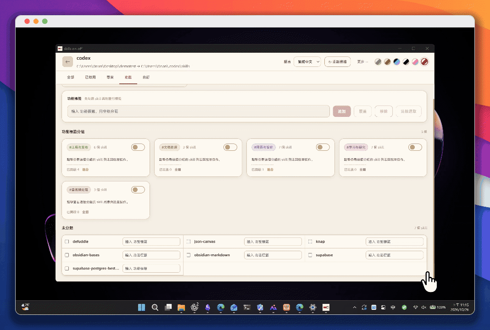
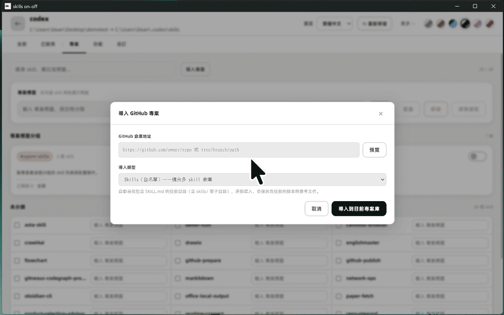
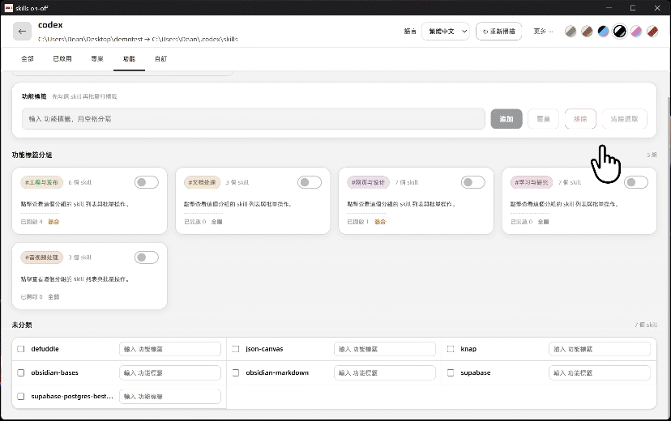

  

<h1 align="center">skills on-off</h1>

<strong>按需启停 AI Agent Skills，按功能整理自己的技能库。</strong>

  <a href="#features">功能与演示</a> ·
  <a href="#start">下载与使用</a> ·
  <a href="#why">为什么做、相关研究</a> ·
  <a href="#credits">致谢、License</a>

  
  
  

<a href="README.en.md">English</a>

---

我收集了不少好用的 Skills，后来却发现，工具变多以后，Codex 有时更难直接动手了：这个办法要研究，那个办法也想试，最后两条路都走一遍。看着它来回犹豫、自己跟自己较劲，时间和 token 就这样花掉了。

所以我做了 skills on-off，先替它减少一些选择。平时把值得保留的技能收进自己的库，按项目和功能整理；准备做一件事时，再打开当前需要的技能。收藏到的好工具可以继续积累，交给 Agent 的技能范围由我决定。

## ✨ 功能与演示

### 按需启用技能

把保存技能的来源目录与 Agent 读取技能的目标目录关联起来，就能在列表里逐个开启技能。启用时，程序把对应内容复制到目标目录；关闭时撤去目标中的对应副本，来源库中的技能仍然保留。切到“已启用”，可以集中查看当前提供给 Agent 的技能。

### 按功能整理技能

写作、检索、代码审查的技能可能来自不同项目。给它们添加功能标签后，可以在“功能”视图中按用途查找，也可以返回“项目”视图查看各个来源。同一个技能可以有多个标签，备注则用来记下用途和注意事项。

### 从 GitHub 导入技能

找到想用的技能仓库后，粘贴 GitHub 地址，预览来源并选择导入方式。导入的技能会形成项目分组，便于一起查看、整理和选择。下面这段实际操作展示了导入 `obsidian-skills`，以及导入后分组中的六个技能。

### 切换界面主题

点击右上角的主题按钮，可以直接切换整套界面配色。六套主题包括莫兰迪、大地色、深色霓虹和复古红白机，选一种自己看着舒服的就好。

## 🚀 下载与使用

当前版本为 **1.2.3**，适用于 **Windows x64**。

1. **[下载 Windows 安装包](https://github.com/Lucian-D-W/skills-on-off/releases/download/v1.2.3/skills-on-off-Setup-1.2.3-x64.exe)。** 文件名为 `skills-on-off-Setup-1.2.3-x64.exe`；[便携版与完整发行文件](https://github.com/Lucian-D-W/skills-on-off/releases/tag/v1.2.3)也在同一版本页面。
2. **安装并打开程序。** 运行安装包，安装完成后打开 skills on-off，日常使用无需安装开发工具。
3. **设置来源与目标。** 来源目录存放自己收集的技能；目标目录选择 Agent 实际读取技能的位置。
4. **选好这次要用的技能。** 在列表或功能分组中开启所需技能，再到“已启用”中查看。

关闭窗口会收起到托盘，需要完全退出时使用托盘菜单。开发者的源码构建步骤见[构建说明](docs/BUILDING.md)。

## 💡 为什么做、相关研究

**参考文献**

**1. SkillsBench: Benchmarking How Well Agent Skills Work Across Diverse Tasks**  
Li 等，2026，arXiv:2602.12670，v4。[论文全文](https://arxiv.org/html/2602.12670v4)。研究发现，经整理的技能能带来收益，但效果随任务、模型和运行框架而异；其数量与复杂度分析中，至多三个模块的聚焦技能优于更大或面面俱到的组合。

**2. How Well Do Agentic Skills Work in the Wild: Benchmarking LLM Skill Usage in Realistic Settings**  
Liu 等，2026，arXiv:2604.04323，v1。[论文全文](https://arxiv.org/html/2604.04323v1)。随着技能选择、检索与适配条件更接近真实使用，技能收益逐步减弱。初始技能具有合理的相关性与质量时，针对当前任务调整技能可以恢复一部分收益。

**3. Choice Overload: A Conceptual Review and Meta-Analysis**  
Chernev、Böckenholt 与 Goodman，2015，Journal of Consumer Psychology，25(2)，333–358。[期刊原文](https://doi.org/10.1016/j.jcps.2014.08.002)。这项关于人的选择行为的综述与元分析指出，选项复杂度、决策难度、偏好不确定性和决策目标，共同影响选择过载。

**设计参考与应用**

我关心的是，收藏了很多技能之后，怎样让眼前的任务真正用上合适的几个。我选择先由人决定当前提供哪些技能，把开关放在管理的中心。前两篇研究也帮助我理解这个取舍：收集到技能之后，它与当前任务是否相关、怎样选择和适配，仍然影响它能否帮上忙。

对我自己来说，大量技能也需要容易整理。我保留按项目分组和按功能分类这两种找法：前者能认出来源，后者更符合“我现在准备做什么”的需要。关于选择过载的研究，则帮助我理解面对大量技能时的整理和选择负担。

## 🙏 致谢、License

感谢 Electron、React、better-sqlite3 和 extract-zip 等项目，为桌面运行、界面、本地记录与仓库导入提供基础；感谢公开分享技能与研究的作者。第三方组件及字体的归属与许可见[第三方通知](THIRD_PARTY_NOTICES.md)。

Copyright © 2026 **Lucian W. (lucian-d-w)**。应用原创代码与作者原创图标采用 **[GPL-3.0-only](LICENSE)**，授权范围见[版权说明](COPYRIGHT.md)。用户导入的 Skills 保留各自许可。
